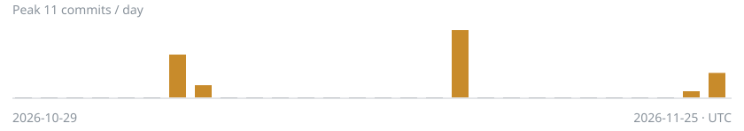

# Yeon Jun Kim · Calavera

CS student and generalist with a passion for exploration. Jack of all trades, master of none. Though lacking depth than a master of one, I often find myself having range letting me connect dots across disciplines.

Recent lab work started in biomedical signal processing, which gave me a strong research foundation, but it’s only one suit in the hand. I enjoy diving into unfamiliar topics across AI, embedded hardware, physics, and astronomy, and seeing where curiosity leads.

I learn best when I can make something and try it for myself. This is where I keep those experiments as I go.

[Explore my portfolio →](https://calavera16.github.io/) · [Browse my repositories](https://github.com/calavera16?tab=repositories)

## My GitHub lately

<!-- analytics:start -->

### Activity

**30** authored commits across **3** repositories on **6** active days.

2026-10-30 – 2026-11-26 · 28 UTC calendar days, including today.

### Languages in my repositories

Python 47.7% · JavaScript 42.0% · TypeScript 5.1% · CSS 3.6% · HTML 1.6% · Other &lt;0.1%

Updated 2026-11-26 UTC · Refresh scheduled twice hourly · 7 public repositories, excluding forks and this profile.

How this is counted

Commits match my GitHub author identity on each repository's default branch, grouped by commit timestamp. Language percentages show GitHub's code bytes across those same default branches.

<!-- analytics:end -->
